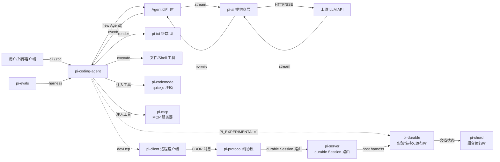
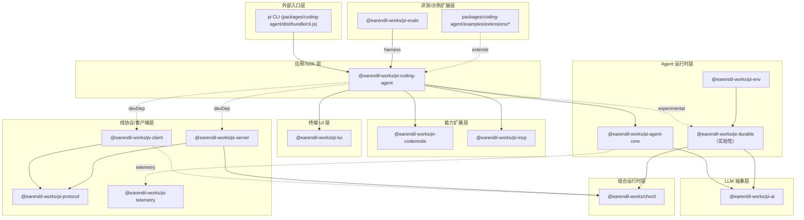
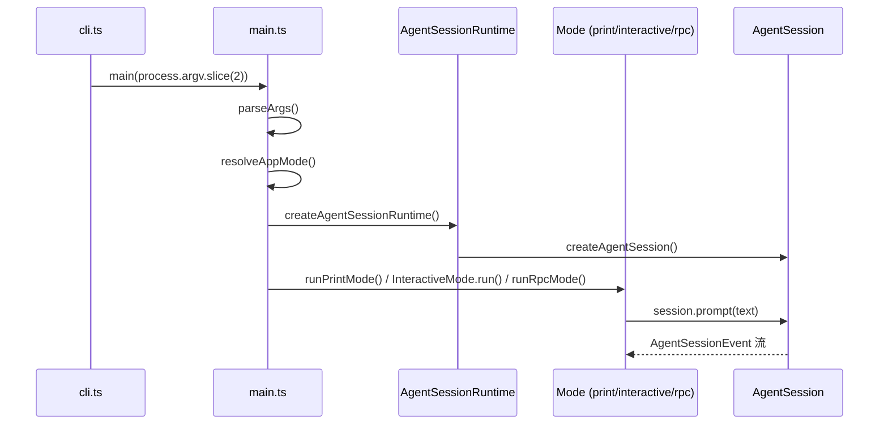
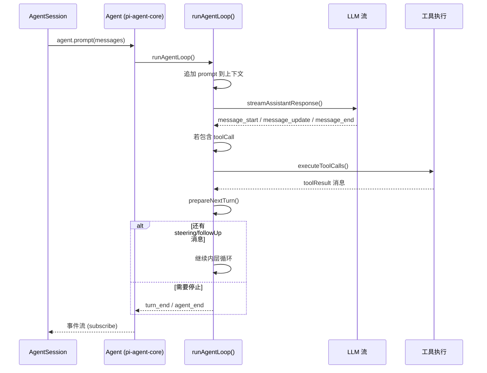
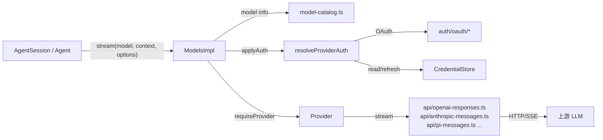
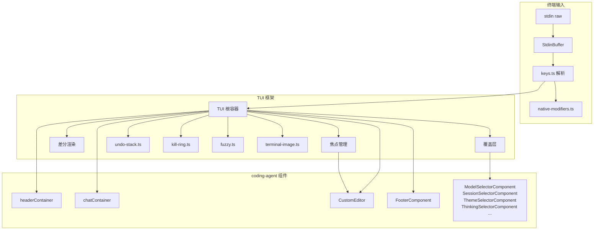
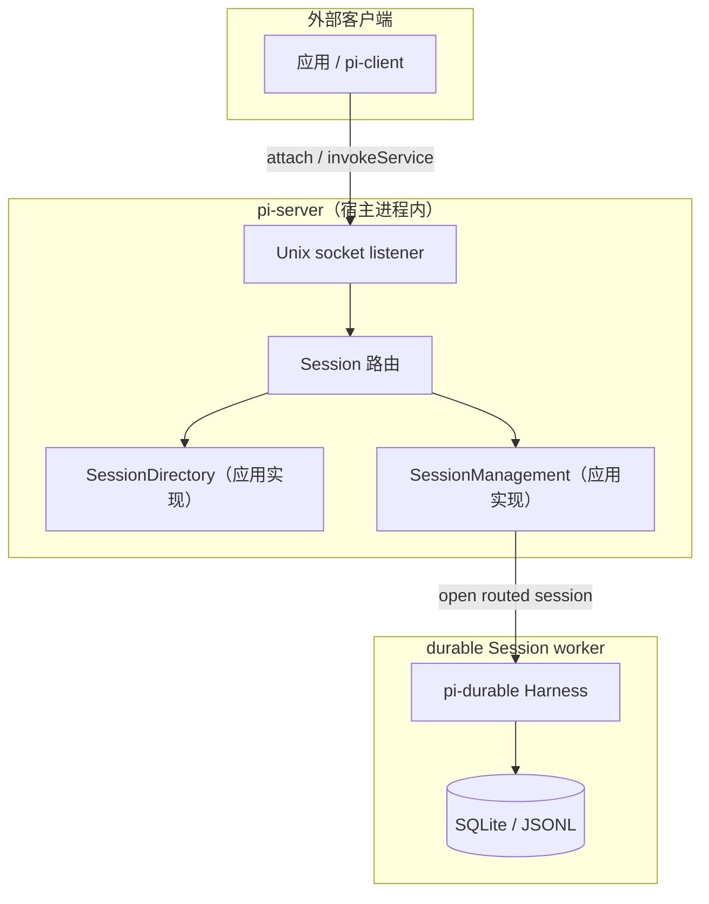

# Pi 软件流程架构分析

> 分析范围：Pi monorepo 核心工作区（`packages/coding-agent`、`packages/agent`、`packages/ai`、`packages/tui`、`packages/durable`、`packages/codemode`、`packages/mcp`、`packages/server`、`packages/client`、`packages/protocol`、`packages/telemetry`、`packages/env`、`packages/chord`、`packages/evals`）以及若干示例扩展工作区，重点描述它们之间的调用与数据流。核对至上游 `e6b9a6af5`（v1.1.0 之后，2026-10-11）。

## 目录

- [1. 概览](#1-概览)
- [2. 包架构分层](#2-包架构分层)
- [3. 入口与运行模式](#3-入口与运行模式)
  - [3.1 CLI 入口](#31-cli-入口)
  - [3.2 运行模式](#32-运行模式)
  - [3.3 模式数据流](#33-模式数据流)
- [4. 核心流程](#4-核心流程)
  - [4.1 CLI 解析与会话解析](#41-cli-解析与会话解析)
  - [4.2 AgentSession 构造](#42-agentsession-构造)
  - [4.3 Agent 循环](#43-agent-循环)
  - [4.4 LLM 提供商抽象](#44-llm-提供商抽象)
  - [4.5 工具执行](#45-工具执行)
  - [4.6 交互式渲染与 TUI](#46-交互式渲染与-tui)
  - [4.7 上下文压缩](#47-上下文压缩)
  - [4.8 会话存储抽象](#48-会话存储抽象)
  - [4.9 Skills、提示模板与扩展系统](#49-skills-提示模板与扩展系统)
  - [4.10 HTML 会话导出](#410-html-会话导出)
- [5. Server：durable Session 路由（实验性）](#5-serverdurable-session-路由实验性)
- [6. Evals 评测框架](#6-evals-评测框架)
- [7. 数据持久化](#7-数据持久化)
- [8. 关键文件索引](#8-关键文件索引)

---

## 1. 概览

Pi 是一个模块化、分层设计的 AI 编程助手运行时：

- **`packages/server`**：实验性的本地路由服务器，把外部客户端路由到应用托管的 durable Session：应用实现 `SessionDirectory`（会话目录投影）与 `SessionManagement`（创建/删除/挂载），服务器按 `{serverId, sessionId, attachmentId}` 校验附件路由，`invokeService()` 不解码业务负载，支持一个会话多个呈现附件。通过 `pi-server/unix` 提供 Unix Domain Socket 传输。纯库、无 CLI，`coding-agent` 仅在实验代码（devDependencies）中使用。
- **`packages/coding-agent`**：主 CLI/SDK，负责参数解析、会话管理、扩展加载、内置工具、运行模式（交互式/一次性/RPC）、Skills、HTML 导出。内置工具之外通过 `pi-codemode`（quickjs 沙箱脚本工具）与 `pi-mcp`（MCP 服务器客户端）扩展；`src/experimental/` 提供 durable TUI、实验客户端/服务器与 Radius 中继（`PI_EXPERIMENTAL=1` 启用）。
- **`packages/agent`**：通用 Agent 运行时，提供多轮对话循环、消息队列（steer/followUp）、工具调度、状态管理。原实验性 harness（会话树/存储抽象/搜索）已迁出至 `pi-durable`，本包现仅保留核心循环。
- **`packages/durable`**：实验性持久 Agent 运行时——会话、模型轮次、工具调用与应用状态先提交存储再展示，进程中途崩溃后重开存储可从断点继续。包含事务会话（fork/checkpoint/migration）、任务运行时（结构化并发、ownership、inbox/submissions、task graph）、压缩与溢出、watch、图像（Photon worker 线程）；存储后端 JSONL / SQLite（`node:sqlite` 与 Cloudflare Durable Object 适配器）/ memory。文档状态基于 `chord`。规范见 `packages/durable/docs/spec.md`。
- **`packages/codemode`**：沙箱化 JavaScript 执行——脚本唯一的能力是调用注入的工具（quickjs-wasi 运行时）；支持经 Cloudflare Workers 远程 Durable Object 运行沙箱。
- **`packages/mcp`**：独立 Model Context Protocol 客户端（stdio / Streamable HTTP 传输、OAuth 授权与动态客户端注册），供 pi 与其他应用复用。
- **`packages/env`**：pi-durable 的远程执行环境——一个通过 SSH 部署的小型守护进程及其 ExecutionEnv 客户端。
- **`packages/ai`**：统一多提供商 LLM API，封装 OpenAI、Anthropic、Google、Bedrock、Mistral 等协议。
- **`packages/tui`**：终端 UI 库，提供差分渲染、组件树、键盘输入、编辑器和覆盖层，默认全屏布局。
- **`packages/chord`**：应用组合运行时——服务、复制状态、RPC、facets、插件；pi-durable 的文档状态与 delta 引擎基于它，`chord/node` 提供插件打包（依赖 esbuild）。
- **`packages/protocol`**：运行时无关的线协议包——schema、类型、CBOR 编解码、字节流 framing，用于客户端与服务器之间的二进制消息。
- **`packages/client`**：传输无关的远程会话客户端（`PiClient`），通过 `ByteTransport` 交换长度前缀 CBOR 消息（依赖 `chord` 的复制状态）。
- **`packages/telemetry`**：遥测包，提供内存/noop 实现，供运行时观察与追踪。
- **`packages/evals`**：内部行为评测包，基于 `vitest-evals` 对 coding-agent 进行端到端评测。

整体数据流向：



---

## 2. 包架构分层



| 层级 | 包 | 主要职责 |
|------|------|----------|
| 外部入口 | `pi-coding-agent` CLI | 参数解析、模式分发、主函数入口（Node esbuild 单文件 bundle） |
| 应用/SDK | `pi-coding-agent` | 会话管理、扩展、内置工具、模式实现、配置、Skills、导出、模型解析、OAuth、codemode/MCP 集成 |
| 能力扩展 | `pi-codemode` | quickjs-wasi 沙箱脚本执行（唯一能力是调用注入工具）、Cloudflare Workers 沙箱 |
| 能力扩展 | `pi-mcp` | 独立 MCP 客户端（传输、OAuth、工具暴露） |
| Agent 运行时 | `pi-agent-core` | 多轮循环、消息队列、工具调度（核心循环；持久化/harness 已移出） |
| 持久运行时（实验性） | `pi-durable` | 事务会话/文档/任务、harness、调度、压缩、watch、图像、存储后端（JSONL/SQLite/Cloudflare DO/memory） |
| 远程执行 | `pi-env` | SSH 部署的远程执行环境守护进程与 ExecutionEnv 客户端（配合 pi-durable） |
| LLM 抽象 | `pi-ai` | 多提供商注册、认证、流式请求、协议转换、模型目录、图像生成 |
| 组合运行时 | `pi-chord` | 复制状态、RPC、facets/services、插件、delta 引擎、bundler |
| 终端 UI | `pi-tui` | 差分渲染、组件、输入、编辑器、覆盖层、图片、全屏布局 |
| 线协议 | `pi-protocol` | schema/类型、CBOR 编解码、字节流 framing、消息校验 |
| 客户端 | `pi-client` | 传输无关的远程客户端（PiClient） |
| 服务器（实验性） | `pi-server` | durable Session 路由服务器（Unix socket、附件路由） |
| 遥测 | `pi-telemetry` | 内存/noop 遥测实现，观测与追踪 |
| 评测 | `pi-evals` | 基于 `vitest-evals` 的端到端行为评测 |
| 示例扩展 | `packages/coding-agent/examples/extensions/*` | 自定义 Provider、沙箱、GitLab Duo 等扩展示例 |

---

## 3. 入口与运行模式

### 3.1 CLI 入口

- **Node 入口**：`packages/coding-agent/src/cli.ts` → `dist/bundle/cli.js`（`bin "pi"`，esbuild 单文件 Node bundle）。
- **Bun 二进制入口**：编译后的 `dist/pi` 同样进入 `cli.ts`。
- **Server**：`packages/server` 现为纯库（无 CLI、无 bin），供实验代码宿主 durable Session 路由服务器。
- **Evals 入口**：`npm run eval -w packages/evals` 依次运行宿主机评测与文档对照评测；后者由 `packages/evals/src/cli.ts` 编排，通过 Docker 隔离运行。模型通过 `PI_PROVIDER` / `PI_MODEL` 指定。

### 3.2 运行模式

`packages/coding-agent/src/main.ts` 中的 `resolveAppMode()` 决定模式：

| 模式 | 触发条件 | 实现文件 | 说明 |
|------|----------|----------|------|
| `interactive` | 默认 TTY | `modes/interactive/interactive-mode.ts` | 启动 TUI，持续对话 |
| `print`（内部）/ `text`（CLI） | `--print`、stdin/stdout 非 TTY，或 `--mode text` | `modes/print-mode.ts` | 一次性输出文本 |
| `json` | `--mode json` | `modes/print-mode.ts`（事件序列化：`modes/json-event.ts`） | 一次性输出 JSONL 事件流；`message_update` 事件携带累计 `usage` |
| `rpc` | `--mode rpc` | `modes/rpc/` | 通过 stdin/stdout JSONL 接收 `RpcCommand` |

### 3.3 模式数据流



---

## 4. 核心流程

### 4.1 CLI 解析与会话解析

**文件**：`packages/coding-agent/src/cli/args.ts`、`packages/coding-agent/src/main.ts`

1. `parseArgs()` 手动解析命令行参数，生成 `Args` 对象（包含 `--model`、`--thinking`、`--session`、`--continue`、`--fork` 等）。
2. 若参数为 `--help`、`--list-models`、`install`、`config` 等元命令，直接短路退出。
3. `resolveSessionPath()` 根据 `--session` / `--continue` / `--resume` / `--fork` 解析会话文件路径：
   - 默认会话目录 `~/.pi/agent/sessions/<encoded-cwd>/`
   - 全局会话目录 `~/.pi/agent/sessions/`
   - 直接文件路径
4. `buildSessionOptions()` 将 CLI 参数映射为 `CreateAgentSessionOptions`。

### 4.2 AgentSession 构造

**文件**：

- `packages/coding-agent/src/core/sdk.ts`
- `packages/coding-agent/src/core/agent-session-services.ts`
- `packages/coding-agent/src/core/agent-session-runtime.ts`
- `packages/coding-agent/src/core/agent-session.ts`

构造链：

```
main.ts
  └─ createAgentSessionRuntime(createRuntime)
       └─ createAgentSessionServices()  # 按 cwd 构建服务
            ├─ ModelRuntime            # core/model-runtime.ts
            ├─ ModelCatalogRefresh      # modes/interactive/model-catalog-refresh.ts（并发刷新协调器；远程目录请求带每次尝试超时，挂起请求中止并重试）
            ├─ SettingsManager         # core/settings-manager.ts
            ├─ ResourceLoader          # core/resource-loader.ts
            ├─ ModelResolver           # core/model-resolver.ts
            ├─ ModelRegistry           # core/model-registry.ts
            ├─ TrustManager            # core/trust-manager.ts
            ├─ AuthStorage / RuntimeCredentials  # core/auth-storage.ts, core/runtime-credentials.ts
            └─ 扩展注册                 # core/extensions/*
       └─ createAgentSessionFromServices()
            └─ createAgentSession()
                 ├─ 解析模型、思考级别
                 ├─ 实例化 pi-agent-core 的 Agent
                 └─ 返回 AgentSession
```

`AgentSession` 是 `coding-agent` 的核心抽象，职责包括：

- 管理 `Agent` 实例、扩展运行时、会话持久化。
- 提供 `prompt()`、`steer()`、`followUp()`、`abort()`、`compact()`、`reload()`、`dispose()`。
- 处理 slash 命令（`/new`、`/fork`、`/model`、`/compact` 等）。
- 在 `agent_start` / `message_end` / `turn_end` 等事件点上持久化会话。
- 支持 `Skill` 块解析与注入、提示模板展开、HTML 导出。
- 管理模型解析与运行时（`ModelRuntime`、`ModelResolver`、`ModelRegistry`）。
- 接入内置扩展 `extensions/mcp`（`pi-mcp` 服务器连接、OAuth 与工具暴露）、`extensions/codemode`（`pi-codemode` 沙箱脚本工具）、`extensions/tool-search` 与 `extensions/llama`。
- 处理项目信任、凭证、OAuth 与 Radius 集成。

### 4.3 Agent 循环

**文件**：

- `packages/agent/src/agent-loop.ts`：底层循环实现。
- `packages/agent/src/agent.ts`：有状态包装器。

`coding-agent` 不再使用 `AgentHarness`，而是由 `AgentSession` 直接包装 `Agent`（`@earendil-works/pi-agent-core`），通过事件订阅和钩子注入所有业务逻辑。



`Agent` 包装器维护：

- `_state`：系统提示词、模型、思考级别、消息历史、工具列表。
- `steeringQueue` / `followUpQueue`：运行中/运行后注入用户消息，drain 策略为 `one-at-a-time` 或 `all`。
- `activeRun`：当前运行的 AbortController 和 Promise。

`AgentSession` 通过四种方式与 `Agent` 交互：

1. **事件订阅**：`agent.subscribe(this._handleAgentEvent)` 返回取消订阅函数（`#9630`）— 接收 `agent_start` / `message_start` / `message_update` / `message_end` / `tool_execution_*` / `turn_end` / `agent_end`，在 `message_end` 时持久化到 `SessionManager`。
2. **工具拦截钩子**：`agent.beforeToolCall` / `agent.afterToolCall` — 转发给 `ExtensionRunner`，扩展可拦截/修改工具调用。
3. **prepareNextTurnWithContext**：在每轮 LLM 调用前注入最新的 `systemPrompt` 和 `tools`。
4. **直接状态读写**：`agent.state.model` / `agent.state.tools` / `agent.state.messages` / `agent.state.systemPrompt`。

### 4.4 LLM 提供商抽象

**文件**：

- `packages/ai/src/models.ts`
- `packages/ai/src/model-catalog.ts`、`models.generated.ts`
- `packages/ai/src/auth/resolve.ts`、`auth/oauth/*`
- `packages/ai/src/api/*.ts`
- `packages/ai/src/providers/*.ts`
- `packages/ai/src/images.ts`、`image-models.generated.ts`



请求流程：

1. `Models.stream(model, context, options)` 立即返回 `AssistantMessageEventStream`（通过 `lazyStream` 隐藏异步）。
2. 在 lazy setup 中，`requireProvider(model)` 按 `model.provider` 查找 Provider；`model-catalog.ts` 与 `models.generated.ts` 提供模型元数据（上下文长度、能力、provider 映射）。
3. `applyAuth()` 调用 `resolveProviderAuth()`：
   - 显式 `apiKey`/`env` 覆盖 > 存储的凭证（API key 或 OAuth）> 环境变量。
   - OAuth 过期时通过 `CredentialStore.modify()` 刷新并持久化；`auth/oauth/*` 支持设备码、PKCE、GitHub Copilot、OpenRouter、Kimi Coding 等多种 OAuth 流程。
4. Provider 调用对应的 API 模块（如 `openai-responses.ts`、`anthropic-messages.ts`、`bedrock-converse-stream.ts`、`google-generative-ai.ts` 等）。
5. API 模块将归一化的 `Context` 转换为提供商特定请求体，创建 SDK 客户端，发起流式请求。
6. 上游事件被解析为标准 `AssistantMessageEvent`：`start`、`text_delta`、`thinking_*`、`toolcall_*`、`done`、`error`。

Provider 生态：`pi-ai` 已内置 OpenAI、Anthropic、Google、Google Vertex、Bedrock、Azure OpenAI、Mistral、Cerebras、DeepSeek、Fireworks、Groq、Together、OpenRouter、GitHub Copilot、Cloudflare、Moonshot、Qwen、MiniMax、xAI、ZAI 等数十个 provider，每个 provider 通常包含 `index.ts` 与 `<name>.models.ts` 分别描述能力与模型列表。`images.ts` 与 `image-models.generated.ts` 提供统一的图像生成入口。部分 provider 有特殊行为：xAI 模型统一通过 Responses API 路由（默认 Grok 4.6）；Google 思考级别遵循官方级别映射；Kimi 追踪缓存 token 用量；ZAI 使用中文 Coding Plan 模型目录；废弃的 Xiaomi 模型已移除。

近期提供商兼容与重试行为（截至上游 `e6b9a6af5`，v1.1.0 后）：

- **Google / Vertex 思考级别**：先由 `clampThinkingLevel()` 选择模型支持的级别，再按 `thinkingLevelMap` 映射；两条 API 共用 `google-shared.ts`。关闭思考时，支持关闭的模型使用 `thinkingBudget: 0`，不支持的模型使用最低支持级别。
- **Anthropic 模型标识与工具**：`AssistantMessage.model` 保留请求模型 ID，服务端返回不同名称时另存 `responseModel`；对话中途新增的工具改为内联定义（不再仅靠首轮 system tools）。Claude Opus/Sonnet/Haiku 5.5 系列改用 models.dev 元数据。
- **采样参数**：`per-thinking-level` 采样参数（#9776）按思考级别覆盖 temperature/top_p 等；Bedrock Converse 上向 OpenAI 模型发送 reasoning effort（#10142）。
- **认证**：Anthropic 支持 workload identity federation（#10242）与 copy code 登录（#10194）；Azure 新增 Foundry Chat Completions 部署（#9714）；OpenAI 登录允许应用声明自身名称（#10433）；Radius 提供商目录与 `/login` Radius 登录；Meta（Muse 订阅 OAuth）。
- **暂时性错误识别**：`utils/retry.ts` 将 Cloudflare HTTP 520、Azure 高峰容量、"Selected model is at capacity"、server-busy、Mistral finish_reason 错误纳入可重试；`Retry-After` 无法解析时退回指数退避；HTTP/2 挂起流取消可重试。
- **分类器与图像**：OpenAI Decisions 分类器、Cloudflare Clef 分类器（Workers AI）、llama.cpp 分类器模型原生支持（#10382）；请求上下文按 3.5 字符/token 估算，各目录保留 prompt-length 分级计价。

### 4.5 工具执行

**文件**：

- `packages/coding-agent/src/core/tools/index.ts` — 工厂函数（`createToolDefinition` / `createTool` / `createAllToolDefinitions`）
- `packages/coding-agent/src/core/tools/read.ts`、`bash.ts`、`edit.ts`、`write.ts`、`grep.ts`、`find.ts`、`ls.ts`、`powershell.ts`
- `packages/coding-agent/src/core/tools/tool-definition-wrapper.ts` — `ToolDefinition` ↔ `AgentTool` 转换
- `packages/coding-agent/src/core/tools/edit-diff.ts` — diff 计算与 fuzzy match
- `packages/coding-agent/src/core/tools/output-accumulator.ts` — bash 流式输出累积
- `packages/coding-agent/src/core/tools/truncate.ts` — 通用截断（2000 行 / 50KB）
- `packages/coding-agent/src/core/tools/file-mutation-queue.ts` — 写操作互斥锁
- `packages/agent/src/agent-loop.ts` 中 `executeToolCalls()`

注：`coding-agent` 有自己独立的工具实现（`packages/coding-agent/src/core/tools/`）；`agent-core` 原有的通用工具实现（`src/harness/tools/`）已随 harness 迁出（`pi-durable` 自带 `src/tools/`），两者互不相关。

工具注册：

- `AgentSession._buildRuntime()` → `createAllToolDefinitions()` 生成内置工具定义（`{read, bash, edit, write, grep, find, ls, powershell}`）→ 存入 `_baseToolDefinitions`。
- 扩展通过 `api.registerTool()` → `ExtensionRunner` → `AgentSession._refreshToolRegistry()` 合并到 `_toolDefinitions` 和 `_toolRegistry`。
- `_refreshToolRegistry()` 合并三路来源：`_baseToolDefinitions` + 扩展注册工具 + SDK 自定义工具，同名工具以扩展/SDK 优先（可覆盖内置工具）。
- `setActiveToolsByName()` → `agent.state.tools = [...]` + 重建 `systemPrompt`。
- 默认工具可配置：`settings.json` 中的 `defaultTools`（`SettingsManager.getDefaultTools()`）覆盖默认的 `[read, bash, edit, write]`，优先级低于 `--tools`/`tools` 选项，且不会移除扩展工具。

执行流程：

1. LLM 返回 `toolCall` 内容块。
2. `agent-loop.ts` 的 `executeToolCalls()` 根据 `toolExecution` 配置选择串行或并行执行。
3. `prepareToolCall()`：查找工具、验证参数、运行 `beforeToolCall` 钩子（扩展拦截）。
4. `executePreparedToolCall()`：调用 `tool.execute()`，可返回流式更新。
5. `finalizeExecutedToolCall()`：运行 `afterToolCall` 钩子（扩展修改结果）。
6. 生成 `toolResult` 消息追加到上下文。

内置工具对比：

| 工具 | Schema | 流式 | 截断 | 互斥 | 特殊能力 |
|------|--------|------|------|------|---------|
| `read` | path/offset/limit | 否 | truncateHead 2000行/50KB | 无 | 图片检测/resize、紧凑渲染分类（docs/skill/resource） |
| `bash` | command/timeout | 是（100ms 节流） | truncateTail + temp 文件 | 无 | 进程树管理、命令前缀、PI_* 环境变量注入 |
| `powershell` | 同 bash（`PowerShellToolInput = BashToolInput`） | 同 bash | 同 bash | 无 | PowerShell 执行（Windows 场景），注入 UTF-8 输出编码前缀，复用 bash 的操作抽象 |
| `edit` | path/edits[] | 否 | 无 | fileMutationQueue | fuzzy match（NFKC/引号/空白/破折号）、异步 diff 预览 |
| `write` | path/content | 是（增量高亮） | 无 | fileMutationQueue | 自动创建父目录、流式语法高亮缓存 |
| `grep` | pattern/path/glob/context/limit | 否 | match limit(100) + 行(500ch) + bytes(50KB) | 无 | 依赖 ripgrep、`.gitignore` 感知 |
| `find` | pattern/path | 否 | 有 | 无 | 文件查找 |
| `ls` | path | 否 | 有 | 无 | 目录列表 |

### 4.6 交互式渲染与 TUI

**文件**：

- `packages/tui/src/tui.ts`
- `packages/tui/src/terminal.ts`
- `packages/tui/src/stdin-buffer.ts`、`keys.ts`、`keybindings.ts`
- `packages/tui/src/layout.ts`、`layout-node.ts`、`tui-alt-screen.ts`、`tui-main-screen.ts`、`wheel-scroll.ts`、`alt-screen-search.ts`
- `packages/tui/src/autocomplete.ts`、`fuzzy.ts`、`kill-ring.ts`、`undo-stack.ts`、`word-navigation.ts`
- `packages/tui/src/terminal-image.ts`、`native-modifiers.ts`、`native-platform.ts`、`program-status.ts`（OSC 7501 状态上报）
- `packages/tui/src/colors.ts`、`oklab.ts`、`latex.ts`
- `packages/tui/src/components/*.ts`
- `packages/coding-agent/src/modes/interactive/interactive-mode.ts`
- `packages/coding-agent/src/modes/interactive/components/*.ts`



交互式模式数据流：

1. 默认由 `ProcessTerminal` 启用 raw mode、Kitty keyboard protocol、bracketed paste；`InteractiveModeOptions.terminal` 可注入其他 `Terminal` 实现，评测可记录渲染输出而不接管真实终端。
2. `StdinBuffer` 将原始输入切分为完整按键序列，识别粘贴事件。
3. `TUI.handleInput()` 将输入路由到当前焦点组件（通常是 `CustomEditor`）。
4. `CustomEditor` 优先处理应用快捷键（中断、退出、粘贴图片、扩展快捷键），其余交给 `Editor`。
5. 编辑器支持自动补全（`autocomplete.ts`）、撤销栈（`undo-stack.ts`）、kill-ring、单词级导航。
6. 用户按 Enter 时，`onSubmit` 回调触发：
   - 斜杠命令（`/settings`、`/model`、`/compact` 等）→ 直接处理。
   - `!command` → bash 执行。
   - 正在 compaction → 排队或执行扩展命令。
   - 正在 streaming → `session.prompt(text, { streamingBehavior: "steer" })`。
   - 否则 → 推入 `pendingUserInputs[]` 或通过 `onInputCallback` 传递。
7. 主循环 `getUserInput()` 从 `pendingUserInputs` 取出消息后调用 `session.prompt(text)`。
8. `AgentSessionEvent` 流通过 `subscribe(listener)` 驱动 `chatContainer` 中的组件更新（`UserMessageComponent`、`AssistantMessageComponent`、`ToolExecutionComponent`、`SkillInvocationMessageComponent` 等）。
9. 每次状态变化调用 `TUI.requestRender()`，`TUI` 差分比较前后帧，只重写变化行。
10. 覆盖层（如模型选择器、会话选择器、主题选择器、思考级别选择器）通过 `showOverlay()` 居中弹出，关闭后焦点返回编辑器。
11. `terminal-image.ts` 与 `native-modifiers.ts` 提供终端图片预览和原生修饰键检测（Windows/macOS 预编译二进制）。
12. 主题：首次运行检测终端背景自动选择 `dark`/`light`；`--use-theme <name>`（或 `light/dark` 终端感知对）可为单次运行设置初始主题而不修改保存的设置，后续在 `/settings` 中切换会立即生效并正常保存。
13. 全屏布局：默认 TUI 模式为 fullscreen（设置 `tuiMode: "fullscreen"`），使用备用屏布局根、滚轮滚动加速（`wheel-scroll.ts`）、alt-screen 内搜索与退出转场（`fullscreenExitOutput`）；传统内联模式可经设置切回。

### 4.7 上下文压缩

**文件**：

- `packages/coding-agent/src/core/compaction/index.ts` — re-export
- `packages/coding-agent/src/core/compaction/compaction.ts` — 核心逻辑（cut point、summarization、compact）
- `packages/coding-agent/src/core/compaction/utils.ts` — 对话序列化、文件操作追踪
- `packages/coding-agent/src/core/compaction/branch-summarization.ts` — 分支摘要

触发时机（`AgentSession._checkCompaction()`）：

1. **Overflow**：LLM 返回 context overflow 错误 → 移除错误消息 → `_runAutoCompaction("overflow", willRetry=true)` → compact 后自动 retry。
2. **Threshold**：每次 `agent_end` 后检查 `contextTokens > contextWindow - reserveTokens(16KB)` → `_runAutoCompaction("threshold", willRetry=false)` → compact 后等待用户继续输入。

压缩流程：

```
_checkCompaction(assistantMsg)
  └─ _runAutoCompaction(reason, willRetry)
       └─ prepareCompaction(entries, settings)
            ├─ 找到上次 compaction 边界 (prevCompactionIndex)
            ├─ findCutPoint() → 从后往前累加 token
            │    保留最近 keepRecentTokens(20K) 的对话
            │    切点只能切在 user/assistant 消息（不切 toolResult）
            │    如果切在 assistant 中间 → isSplitTurn
            ├─ 提取 messagesToSummarize（丢弃的历史）
            ├─ 提取 turnPrefixMessages（如果跨回合切断）
            └─ 提取 fileOps（读/写过的文件）
       └─ compact(preparation)
            ├─ 扩展 session_before_compact 事件（可提供自定义 compaction）
            ├─ 调用 LLM 生成结构化摘要
            │   ├─ 有 previousSummary → UPDATE_SUMMARIZATION_PROMPT（增量更新）
            │   └─ 无 → SUMMARIZATION_PROMPT（全新总结）
            ├─ 跨回合时额外生成 turn prefix 摘要
            └─ 返回 { summary, firstKeptEntryId, tokensBefore, usage, details }
```

摘要请求的会话路由：`completeSummarization()` 复用调用方传入的 `sessionId`，使压缩摘要与当前会话使用相同的路由/Provider 配置；无会话 ID 的调用（如分支摘要）使用全新路由 ID，且摘要请求不写缓存（`cacheRetention: "none"`）。

压缩失败或中止时触发 `session_compact_failed` 扩展事件（`reason` 为 `manual`/`threshold`/`overflow`，另含 `errorMessage`、`aborted`、`willRetry`、`fromExtension`），与 `session_before_compact` / `session_compact` 配对，供遥测扩展追踪压缩结局。

压缩后：

```typescript
this.sessionManager.appendCompaction(summary, firstKeptEntryId, tokensBefore, details, fromExtension, usage);
const sessionContext = this.sessionManager.buildSessionContext();
this.agent.state.messages = sessionContext.messages;
```

Session 文件结构变为：
```
[header][compactionEntry][保留的最新消息...]
             ↑
      summary + firstKeptEntryId
```

摘要格式为结构化 Markdown：`## Goal` / `## Progress` / `## Key Decisions` / `## Next Steps` / `## Critical Context`，末尾附加 `## Files Read` / `## Files Modified`。

### 4.8 会话存储抽象

**背景**：`pi-agent-core` 原有的实验性 harness（`packages/agent/src/harness/`：会话树抽象、`SessionStorage` 接口、JSONL/SQLite 后端、跨会话搜索）已于上游迁出——会话/存储实现进入 `packages/durable`，跨会话搜索（`packages/agent/src/search/`）被移除，`packages/session-backends/sqlite-node` 包随之删除。`packages/agent/docs/harness.md` 规范同样移除，由 `packages/durable/docs/spec.md` 取代。

**文件**：

- `packages/durable/src/session/`（`session.ts`、`transaction.ts`、`forks.ts`、`observation.ts`）— 事务会话与文档
- `packages/durable/src/harness/`（`harness.ts`、`agent.ts`、`scheduler.ts`、`inbox.ts`、`submissions.ts`、`task-graph.ts`、`compaction.ts`、`view.ts`、`registry.ts` 等）— durable harness 与任务运行时
- `packages/durable/src/storage/`（`jsonl/`、`sqlite/`、`memory.ts`、`scan.ts`）— 存储后端
- `packages/durable/src/documents.ts`、`entries.ts`、`tasks.ts`、`images/`、`env/`、`tools/`
- `packages/durable/docs/spec.md` — 规范（Packages 15–23：首个 chat turn → 生命周期 → 扩展）
- `packages/coding-agent/src/core/session-manager.ts` — coding-agent 自身的 JSONL 会话管理（与 pi-durable 并行，主 CLI 仍使用）

`pi-durable`（实验性）的核心模型：

1. **先落盘再展示**：会话、模型轮次、工具调用与应用状态先提交存储，进程死亡后重开存储从断点继续（"效果三明治"：intent → 执行 → settlement）。
2. **事务会话与文档**：版本化文档、fork、checkpoint、迁移；文档状态基于 `chord` 的 operation log/delta；`documentRetentionMs` 按使用度约束文档缓存内存。
3. **任务运行时（TaskRuntime）**：结构化并发——任务 ownership、等待/完成 holds、自底向上中止、嵌套调用（每个嵌套调用一个文档）、inbox/submissions、task graph 视图；调度器索引只按活跃工作约束内存。
4. **压缩与溢出**：durable 侧 compaction/overflow（Package 20）。
5. **其他**：`FileSystem.watch`（Windows 上退化为轮询）、有界二进制/目录读取、图像读取（Photon worker 线程准备）、按 SQL 文本执行并缓存语句的异步 SQLite。

存储后端：

| 后端 | 实现 | 说明 |
|------|------|------|
| JSONL | `packages/durable/src/storage/jsonl/` | Node 端 JSONL 存储 |
| SQLite | `packages/durable/src/storage/sqlite/` | `node:sqlite` 实现 + Cloudflare Durable Object（`cloudflare.ts`）适配器，含迁移 |
| Memory | `packages/durable/src/storage/memory.ts` | 内存实现，测试用 |
| 扫描 | `packages/durable/src/storage/scan.ts` | 有界扫描（会话/条目/任务/提交按任意顺序扫描） |

`coding-agent` 主 CLI 当前默认仍使用自己的 JSONL `SessionManager`（`packages/coding-agent/src/core/session-manager.ts`），与 `pi-durable` 的存储抽象并行；`pi-durable` 通过 `coding-agent/src/experimental/durable/`（durable TUI：单进程拥有模型运行时、durable harness、SQLite 存储与 TUI）与 `experimental/vacation/`（示例应用）落地。

### 4.9 Skills、提示模板与扩展系统

**文件**：

- `packages/coding-agent/src/core/skills.ts`
- `packages/coding-agent/src/core/prompt-templates.ts`
- `packages/coding-agent/src/core/system-prompt.ts`
- `packages/coding-agent/src/core/slash-commands.ts`

Skills：

- 从 `.pi/skills/`、项目 `.skills/` 或显式路径加载 `SKILL.md` 文件。
- 发现规则：
  - 在 `~/.pi/agent/skills/` 与 `.pi/skills/` 中，根级 `.md` 文件仅在拥有有效 skill frontmatter 且 `description` 非空时才作为独立 skill 加载。
  - 所有 skill 位置中，包含 `SKILL.md` 的目录被递归发现。
  - 在 `~/.agents/skills/` 与项目 `.agents/skills/` 中，根级 `.md` 文件被忽略，但分组目录内的嵌套 `.md` 文件在声明 skill frontmatter 时会被发现。
  - 不含 skill frontmatter 的普通 Markdown 文件被静默忽略。
- 解析 YAML frontmatter（`name`、`description`、`disable-model-invocation`）。
- 以 XML 块形式注入系统提示词，供模型参考。
- 用户可在输入中使用 `<skill name="..." location="...">...</skill>` 块显式调用。

提示模板：

- 从 `.pi/prompts/` 或项目 `.prompts/` 加载模板。
- 支持参数插值，通过 slash 命令或显式调用展开为 prompt。

扩展系统：

- `packages/coding-agent/src/core/extensions/index.ts`：类型与函数 re-export。
- `packages/coding-agent/src/core/extensions/loader.ts`：扩展发现与加载（本地目录、npm 包、内置扩展）。
- `packages/coding-agent/src/core/extensions/runner.ts`：`ExtensionRunner` 生命周期、事件钩子和资源管理。
- `packages/coding-agent/src/core/extensions/types.ts`：扩展 API 完整类型，包括工具注册、UI 组件/对话框/快捷键、主题、provider 注册、OAuth、生命周期事件等。
- `packages/coding-agent/src/core/extensions/wrapper.ts`：对扩展注册工具的包装与权限控制。

扩展可注入的能力包括：

- 自定义工具（自动/手动调用）与 slash 命令。
- 自定义 LLM provider（模型解析、流式请求、模型列表）。
- TUI 组件、覆盖层对话框、主题、快捷键、编辑器增强。
- OAuth 提供者、凭证存储、Radius 集成。
- 生命周期钩子：`onAgentStart`、`beforeToolCall`、`afterToolCall`、`beforeProviderRequest`、`afterProviderResponse` 等。

内置扩展（`packages/coding-agent/src/extensions/`）：

- `mcp/`：包装 `pi-mcp` 客户端——服务器连接、OAuth（动态客户端注册、RFC 9207 `iss` 校验、step-up 授权、按服务器名+URL 存储凭证）、`/mcp` 命令、工具暴露与 pattern 过滤（`--tools`、`--no-mcp`、工具 pattern）。
- `codemode/`：包装 `pi-codemode`——quickjs 沙箱脚本工具（唯一能力是调用注入的工具）、脚本输出上限与 `image()` 输出保存临时文件、分类器与嵌套工具用量计入会话成本。
- `tool-search/`：MCP 工具按需搜索加载（reload 后恢复已加载工具）。
- `llama/`：本地 LLaMA 推理支持（`client.ts`、`provider.ts`、`ui.ts`、`huggingface.ts`、`index.ts`）。模型发现允许网络请求，sleeping 中的模型也会暴露；guidance 无默认值。若路由器以 `--no-models-autoload` 启动，`/login llama.cpp` 仅保存连接，需 `/llama` 加载模型后再 `/model` 选择。

### 4.10 HTML 会话导出

**文件**：

- `packages/coding-agent/src/core/export-html/index.ts`
- `packages/coding-agent/src/core/export-html/tool-renderer.ts`
- `packages/coding-agent/src/core/export-html/template.html`

功能：

- 将 JSONL 会话文件渲染为独立 HTML 页面。
- 使用当前主题配色，支持 ANSI 转 HTML、代码高亮、Markdown 渲染。
- 扩展可提供 `ToolHtmlRenderer` 自定义工具输出渲染。
- 交互式模式通过 `/export` 或 `--export` 参数触发。

---

## 5. Server：durable Session 路由（实验性）

**文件**：

- `packages/server/src/server.ts` — 路由服务器主体（`ServerHost`、`RoutedServerServiceHost`、`RoutedSessionHandle`）
- `packages/server/src/session-router.ts` — 会话路由与附件管理
- `packages/server/src/connection.ts`、`listener.ts` — 连接与监听
- `packages/server/src/transports/` — 传输实现（`pi-server/unix` 提供 Unix socket）
- `packages/server/src/errors.ts`、`types.ts`、`index.ts`

上游已移除旧的多实例守护进程（`serve`/`spawn`/`rpc-stream` 子命令、`ServerSupervisor`、`instances.json`、Radius 注册）。现在的 `pi-server` 是一个纯库：



职责划分：

1. **应用持有目录与管理**：`SessionDirectory` 把私有会话目录投影为复制后的呈现安全状态；`SessionManagement` 创建、删除、挂载（attach）、卸载会话，路由 ID 不进入业务结果。
2. **附件路由**：`attachClient()` 建立连接级服务端点；同一连接重复 attach 幂等，每个成功附件有服务器生成的 `attachmentId`（仅作为路由控制数据下发）。会话请求携带 `{serverId, sessionId, attachmentId}`，过期或不匹配的路由被拒绝；连接丢失时拒绝其本地响应，待已受理的服务调用结算后释放附件。
3. **不透明转发**：`invokeService()` 把不透明的 service/member 信封转发给所选 Session 端点，服务器校验附件路由但不加载 facet 契约、不解码业务负载；订阅更新只发回请求附件。一个会话可有多个呈现附件。
4. **worker 生命周期**：宿主决定何时在零呈现需求且 worker 内 Harness 空闲时退役 worker；服务器关闭时关闭所有路由 Session 句柄，释放 worker 与 Session 写者所有权。

`coding-agent` 侧的实验接入（`PI_EXPERIMENTAL=1`）：`src/experimental/` 下的 `client.ts`/`client-tui.ts`（实验客户端与 TUI）、`coordinator.ts`、`session-worker-manager.ts`、`server.ts` 与 `radius-relay.ts`（Radius 中继），通过 devDependencies 引入 `pi-client`/`pi-protocol`/`pi-server`。

---

## 6. Evals 评测框架

**文件**：

- `packages/evals/src/harness.ts`
- `packages/evals/src/cli.ts`、`docker.ts`、`plan.ts`、`report.ts`
- `packages/evals/evals/smoke.eval.ts`、`documentation-audit.eval.ts`
- `packages/evals/evals/*.docs.eval.ts`（扩展、模型、Provider、TUI 文档对照评测）

`pi-evals` 是私有包，不发布到 npm，基于 `vitest-evals` 对 `pi-coding-agent` 进行端到端行为评测：

1. `createPiCodingAgentHarness()` 创建隔离临时目录与 `AgentSession`，通过显式模型选项或 `PI_PROVIDER` / `PI_MODEL` 选择模型。
2. 执行 `prompt` / `reload` 步骤，收集 assistant 输出、工具调用、token 用量与会话快照。
3. 从 `session.messages` 中用 `getCurrentSystemPrompt()` 提取实际对话中的系统提示词，校验规则与文档段，而不是读取 reload 后可能重建的 `session.systemPrompt`。
4. 将结果归一化为 `TranscriptEvent` 与 usage 统计，供 `vitest-evals` 评分。运行后校验或输出处理失败时，已收集的事件、用量与提示词摘要仍附在部分运行结果中；报告保留可读取的指标，但将该次运行标记为 `errored`。

文档对照评测由 `cli.ts` 为每个用例规划 `without_docs` / `with_docs` 两组运行，在独立 Docker 容器中执行，比较有无 Pi 文档时的得分。`createPiDocumentationEvalHarness()` 默认仅提供文件读写与搜索工具，不暴露 bash；它要求容器环境及非特权用户沙箱。缺失、出错或无分数的配对不计入成功率提升，并阻止发布整体提升指标。

TUI 用例 `tui.docs.eval.ts` 要求模型编写上下文进度条扩展，reload 后注入 `RecordingTerminal`，采集真实 `InteractiveMode` 渲染。它检查 42.2%、65%、120% 三组上下文用量，验证十格进度条及 0–100% 截断，并用 `autoevals` 的 Levenshtein 相似度记录其余状态文本的保留程度；这不是将进度条直接加入内置 footer。

运行方式（会调用真实模型；文档对照还需要 Docker）：

```bash
# 宿主机评测，然后运行文档对照
PI_PROVIDER=<provider> PI_MODEL=<model> npm run eval -w packages/evals

# 仅运行文档对照
npm run eval:docs -w packages/evals -- --provider <provider> --model <model>
```

对照产物写入 `packages/evals/.eval/<timestamp>_<id>/`，包含运行计划、规范化观察结果、原生会话文件及 `report.json` / `report.txt`。

---

## 7. 数据持久化

| 数据 | 位置 | 说明 |
|------|------|------|
| Agent 配置目录 | `~/.pi/agent/`（可通过 `PI_CODING_AGENT_DIR` 覆盖） | 所有 coding-agent 数据根目录 |
| 会话历史（JSONL） | `~/.pi/agent/sessions/<encoded-cwd>/<id>.jsonl` | 树状结构的消息、模型变更、思考级别变更、压缩摘要 |
| 会话历史（SQLite，实验性） | `<db-path>`（可配置） | `pi-durable` 的 SQLite 存储后端（`node:sqlite` + Cloudflare Durable Object 适配器），服务实验性 durable harness |
| 设置 | `~/.pi/agent/settings.json` | 用户偏好、模型、Provider 凭证引用 |
| 凭证 | 系统密钥存储 / `~/.pi/agent/credentials` | API key / OAuth token（由 `CredentialStore` 抽象） |
| 模型缓存 | `~/.pi/agent/models.json` | 各 Provider 的动态模型列表缓存 |
| Server Unix socket（实验性） | 由 `pi-server/unix` 的 `getUnixSocketPath()` 决定 | 实验路由服务器监听地址 |

会话条目类型（`SessionTreeEntry`）：

- `message`
- `thinking_level_change`
- `model_change`
- `active_tools_change`
- `compaction`
- `branch_summary`
- `custom` / `custom_message`
- `label`
- `session_info`
- `leaf`

---

## 8. 关键文件索引

### Server（实验性）

| 文件 | 职责 |
|------|------|
| `packages/server/src/server.ts` | 路由服务器主体（`ServerHost`、`RoutedServerServiceHost`、`RoutedSessionHandle`） |
| `packages/server/src/session-router.ts` | 会话路由与附件管理 |
| `packages/server/src/connection.ts` | 连接生命周期 |
| `packages/server/src/listener.ts` | 监听器 |
| `packages/server/src/transports/` | 传输实现（`pi-server/unix` 导出 Unix socket） |
| `packages/server/src/errors.ts` | 错误类型（`SessionNotFoundError` 等） |
| `packages/server/src/types.ts` | 路由/附件类型 |
| `packages/server/src/index.ts` | server 公共导出 |

### Coding Agent

| 文件 | 职责 |
|------|------|
| `packages/coding-agent/src/cli.ts` | `pi` CLI 入口 |
| `packages/coding-agent/src/main.ts` | 参数解析、模式路由、会话/运行时构建 |
| `packages/coding-agent/src/core/sdk.ts` | 程序化 SDK：`createAgentSession()` |
| `packages/coding-agent/src/core/agent-session-services.ts` | 按 cwd 构建服务 |
| `packages/coding-agent/src/core/agent-session-runtime.ts` | 运行时与会话切换 |
| `packages/coding-agent/src/core/agent-session.ts` | 核心会话抽象与事件流（~4400行） |
| `packages/coding-agent/src/core/session-manager.ts` | JSONL 会话管理 |
| `packages/coding-agent/src/core/model-runtime.ts` | 模型运行时与调度 |
| `packages/coding-agent/src/core/model-resolver.ts` | 模型字符串解析 |
| `packages/coding-agent/src/core/model-registry.ts` | 模型元数据注册 |
| `packages/coding-agent/src/core/model-config.ts` | 模型配置（思考级别、上下文等） |
| `packages/coding-agent/src/core/models-store.ts` | 模型列表缓存 |
| `packages/coding-agent/src/modes/interactive/model-catalog-refresh.ts` | 模型目录并发刷新协调器（共享同一刷新、abort 感知等待） |
| `packages/coding-agent/src/core/remote-catalog-provider.ts` | 远程模型目录拉取（每次尝试 4s 超时，挂起请求中止并重试） |
| `packages/coding-agent/src/utils/management-http.ts` | `fetchWithRetry`：整体时间预算 + 每次尝试超时 |
| `packages/coding-agent/src/utils/pi-user-agent.ts` | pi User-Agent 构造（模型目录/管理请求） |
| `packages/coding-agent/src/core/provider-composer.ts` | Provider 组合（扩展自定义 provider/OAuth 配置） |
| `packages/coding-agent/src/core/provider-attribution.ts` | Provider 归属跟踪 |
| `packages/coding-agent/src/core/settings-manager.ts` | 用户设置读写 |
| `packages/coding-agent/src/core/settings-defaults.ts` | 设置默认值（`tuiMode: "fullscreen"` 等） |
| `packages/coding-agent/src/core/settings-schema.ts` | 设置 schema（随配置 schema 发布） |
| `packages/coding-agent/src/core/cache-warmer.ts` | 提示缓存预热（#9668） |
| `packages/coding-agent/src/core/bug-report.ts` | bug 报告生成与离线拒绝 |
| `packages/coding-agent/src/core/mcp-servers.ts` | MCP 服务器配置解析（项目 mcp.json 覆盖全局启用/暴露） |
| `packages/coding-agent/src/core/nested-tool-calls.ts` | 嵌套工具调用 |
| `packages/coding-agent/src/core/session-export.ts` | 会话导出 |
| `packages/coding-agent/src/core/experimental.ts` | 实验特性开关（`PI_EXPERIMENTAL=1`） |
| `packages/coding-agent/src/core/defaults.ts` | 默认值常量 |
| `packages/coding-agent/src/core/resolve-config-value.ts` | 配置值解析（env/命令/值） |
| `packages/coding-agent/src/core/resource-loader.ts` | Skill / 提示模板 / 主题资源加载 |
| `packages/coding-agent/src/core/trust-manager.ts` | 项目信任与权限决策 |
| `packages/coding-agent/src/core/project-trust.ts` | 项目信任解析 |
| `packages/coding-agent/src/core/auth-storage.ts` | 认证凭证存储 |
| `packages/coding-agent/src/core/runtime-credentials.ts` | 运行时凭证解析 |
| `packages/coding-agent/src/core/bash-executor.ts` | 统一 bash 执行（AgentSession.executeBash） |
| `packages/coding-agent/src/core/event-bus.ts` | 事件总线抽象 |
| `packages/coding-agent/src/core/pi-manifest.ts` | pi manifest 解析（extensions/skills 配置） |
| `packages/coding-agent/src/core/diagnostics.ts` | 诊断信息 |
| `packages/coding-agent/src/core/exec.ts` | 进程执行工具 |
| `packages/coding-agent/src/core/output-guard.ts` | stdout 接管保护 |
| `packages/coding-agent/src/core/radius.ts` | Radius 集成 |
| `packages/coding-agent/src/core/telemetry.ts` | 遥测 |
| `packages/coding-agent/src/core/timings.ts` | 启动计时（PI_TIMING=1） |
| `packages/coding-agent/src/core/footer-data-provider.ts` | Footer 数据提供（git 分支、扩展状态） |
| `packages/coding-agent/src/core/keybindings.ts` | 快捷键配置管理 |
| `packages/coding-agent/src/core/usage-totals.ts` | token 用量统计 |
| `packages/coding-agent/src/core/cache-stats.ts` | 缓存命中率统计 |
| `packages/coding-agent/src/core/http-dispatcher.ts` | HTTP 代理配置 |
| `packages/coding-agent/src/core/extensions/index.ts` | 扩展系统 re-export |
| `packages/coding-agent/src/core/extensions/loader.ts` | 扩展发现与加载 |
| `packages/coding-agent/src/core/extensions/runner.ts` | 扩展运行时与生命周期钩子 |
| `packages/coding-agent/src/core/extensions/types.ts` | 扩展 API 类型 |
| `packages/coding-agent/src/core/extensions/wrapper.ts` | 扩展工具包装 |
| `packages/coding-agent/src/core/compaction/compaction.ts` | 上下文压缩核心逻辑 |
| `packages/coding-agent/src/core/compaction/utils.ts` | 对话序列化、文件操作追踪 |
| `packages/coding-agent/src/core/compaction/branch-summarization.ts` | 分支摘要 |
| `packages/coding-agent/src/core/tools/index.ts` | 内置工具工厂 |
| `packages/coding-agent/src/core/tools/read.ts` | read 工具实现 |
| `packages/coding-agent/src/core/tools/bash.ts` | bash 工具实现（OutputAccumulator、进程树管理） |
| `packages/coding-agent/src/core/tools/edit.ts` | edit 工具实现（fuzzy match、异步 diff 预览） |
| `packages/coding-agent/src/core/tools/edit-diff.ts` | diff 计算引擎 |
| `packages/coding-agent/src/core/tools/write.ts` | write 工具实现（流式语法高亮缓存） |
| `packages/coding-agent/src/core/tools/grep.ts` | grep 工具实现（ripgrep JSON 流） |
| `packages/coding-agent/src/core/tools/find.ts` | find 工具实现 |
| `packages/coding-agent/src/core/tools/ls.ts` | ls 工具实现 |
| `packages/coding-agent/src/core/tools/powershell.ts` | PowerShell 工具实现（复用 bash 操作抽象） |
| `packages/coding-agent/src/core/tools/output-accumulator.ts` | bash 流式输出累积与截断 |
| `packages/coding-agent/src/core/tools/truncate.ts` | 通用截断（2000 行 / 50KB / 500ch 每行） |
| `packages/coding-agent/src/core/tools/file-mutation-queue.ts` | 写操作互斥锁 |
| `packages/coding-agent/src/core/tools/tool-definition-wrapper.ts` | ToolDefinition ↔ AgentTool 转换 |
| `packages/coding-agent/src/core/tools/path-utils.ts` | 路径解析工具 |
| `packages/coding-agent/src/core/tools/render-utils.ts` | TUI 渲染辅助 |
| `packages/coding-agent/src/core/skills.ts` | Skill 加载与解析 |
| `packages/coding-agent/src/core/prompt-templates.ts` | 提示模板加载与展开 |
| `packages/coding-agent/src/core/slash-commands.ts` | slash 命令解析与分发 |
| `packages/coding-agent/src/core/export-html/index.ts` | 会话 HTML 导出 |
| `packages/coding-agent/src/modes/print-mode.ts` | 一次性文本/JSON 模式 |
| `packages/coding-agent/src/modes/interactive/interactive-mode.ts` | 交互式 TUI 模式（~7100行，默认全屏布局） |
| `packages/coding-agent/src/modes/rpc/` | RPC 模式 |
| `packages/coding-agent/src/rpc-entry.ts` | server 子进程 RPC 入口 |
| `packages/coding-agent/src/bun/cli.ts` | Bun 二进制入口包装 |

### Agent Core

| 文件 | 职责 |
|------|------|
| `packages/agent/src/agent.ts` | 有状态 Agent 包装器（~610行） |
| `packages/agent/src/agent-loop.ts` | 多轮 LLM/工具循环（~950行） |
| `packages/agent/src/types.ts` | 核心类型 |
| `packages/agent/src/stream-fn.ts` | 默认流函数 |
| `packages/agent/src/proxy.ts` | Agent 代理 |
| `packages/agent/src/index.ts` | 公共导出 |

注：原 `packages/agent/src/harness/`（会话树抽象、`SessionStorage`、JSONL/SQLite 后端）、`src/search/` 与 `docs/harness.md` 已随实验 harness 迁出至 `pi-durable` / 移除，见第 4.8 节。

### AI

| 文件 | 职责 |
|------|------|
| `packages/ai/src/models.ts` | Provider / Models 注册与调度 |
| `packages/ai/src/models-store.ts` | 动态模型列表缓存 |
| `packages/ai/src/model-catalog.ts` | 模型目录与能力元数据 |
| `packages/ai/src/models.generated.ts` | 生成的主干模型数据 |
| `packages/ai/src/types.ts` | 统一消息/上下文/事件类型 |
| `packages/ai/src/auth/resolve.ts` | 认证解析与 OAuth 刷新 |
| `packages/ai/src/auth/credential-store.ts` | 凭证存储默认实现 |
| `packages/ai/src/auth/oauth/*` | 各 Provider OAuth 实现（PKCE、device code 等） |
| `packages/ai/src/api/lazy.ts` | 懒加载流封装 |
| `packages/ai/src/api/pi-messages.ts` | Pi 自有协议 |
| `packages/ai/src/api/openai-responses.ts` | OpenAI Responses API |
| `packages/ai/src/api/anthropic-messages.ts` | Anthropic Messages API |
| `packages/ai/src/api/bedrock-converse-stream.ts` | Bedrock Converse 流式 API |
| `packages/ai/src/api/google-generative-ai.ts` | Google Gemini API |
| `packages/ai/src/images.ts` | 图像生成入口 |
| `packages/ai/src/image-models.generated.ts` | 生成的图像模型数据 |
| `packages/ai/src/providers/faux.ts` | 测试用伪 Provider |
| `packages/ai/src/providers/openai/` | OpenAI provider 与模型列表 |
| `packages/ai/src/providers/anthropic/` | Anthropic provider 与模型列表 |
| `packages/ai/src/providers/google/` | Google provider 与模型列表 |
| `packages/ai/src/providers/amazon-bedrock/` | Bedrock provider 与模型列表 |
| `packages/ai/src/providers/openrouter/` | OpenRouter provider 与模型列表 |

### TUI

| 文件 | 职责 |
|------|------|
| `packages/tui/src/tui.ts` | TUI 根容器、差分渲染、焦点、覆盖层 |
| `packages/tui/src/layout.ts`、`layout-node.ts` | 全屏布局引擎 |
| `packages/tui/src/tui-alt-screen.ts`、`tui-main-screen.ts` | 备用屏/主屏模式 |
| `packages/tui/src/terminal.ts` | 终端抽象、协议协商 |
| `packages/tui/src/stdin-buffer.ts` | 原始输入缓冲与序列切分 |
| `packages/tui/src/keys.ts` | 按键序列解析 |
| `packages/tui/src/keybindings.ts` | 快捷键注册 |
| `packages/tui/src/wheel-scroll.ts` | 全屏滚轮滚动（自动加速） |
| `packages/tui/src/alt-screen-search.ts` | 全屏内搜索 |
| `packages/tui/src/components/editor.ts` | 多行编辑器 |
| `packages/tui/src/components/markdown.ts` | Markdown 渲染 |
| `packages/tui/src/components/select-list.ts` | 选择列表 |
| `packages/tui/src/components/settings-list.ts` | 设置列表 |
| `packages/tui/src/components/box.ts` | 带背景的容器 |
| `packages/tui/src/components/image.ts` | 终端图片组件 |
| `packages/tui/src/components/input.ts` | 单行输入组件 |
| `packages/tui/src/components/loader.ts` | 加载动画 |
| `packages/tui/src/components/scroll-view.ts`、`mouse-region.ts`、`stack.ts`/`h-stack.ts`/`v-stack.ts`、`text.ts` | 布局与交互基础组件 |
| `packages/tui/src/colors.ts`、`oklab.ts` | 颜色值与主题 styling（#8398） |
| `packages/tui/src/latex.ts` | LaTeX 兼容渲染 |
| `packages/tui/src/program-status.ts` | OSC 7501 程序状态上报 |
| `packages/tui/src/autocomplete.ts` | 编辑器自动补全 |
| `packages/tui/src/fuzzy.ts` | 模糊匹配 |
| `packages/tui/src/kill-ring.ts` | kill-ring 剪贴 |
| `packages/tui/src/undo-stack.ts` | 编辑器撤销栈 |
| `packages/tui/src/word-navigation.ts` | 单词级光标移动 |
| `packages/tui/src/terminal-image.ts` | 终端图片渲染 |
| `packages/tui/src/native-modifiers.ts`、`native-platform.ts` | 原生修饰键检测 |

### Protocol (线协议)

| 文件 | 职责 |
|------|------|
| `packages/protocol/src/cbor/encoder.ts` | CBOR 编码器 |
| `packages/protocol/src/cbor/decoder.ts` | CBOR 解码器 |
| `packages/protocol/src/cbor/options.ts` | CBOR 选项 |
| `packages/protocol/src/framing.ts` | 字节流 framing（4 字节长度前缀 + CBOR 项） |
| `packages/protocol/src/protocol.ts` | 消息 schema（hello、request/response、event 信封） |
| `packages/protocol/src/codec.ts` | 客户端/服务端消息编解码与校验 |
| `packages/protocol/src/index.ts` | 公共导出 |

### Client (远程会话客户端)

| 文件 | 职责 |
|------|------|
| `packages/client/src/client.ts` | `PiClient`：连接、会话管理、快照订阅 |
| `packages/client/src/connection.ts` | 连接生命周期与重连 |
| `packages/client/src/transport.ts` | `ByteTransport` 接口 |
| `packages/client/src/unix.ts` | Unix socket 传输 |
| `packages/client/src/promise.ts` | Promise 辅助 |
| `packages/client/src/errors.ts` | 错误类型 |
| `packages/client/src/types.ts` | 客户端类型 |

### Durable（实验性持久运行时）

| 文件 | 职责 |
|------|------|
| `packages/durable/src/harness/harness.ts` | durable Harness（registry、会话配置） |
| `packages/durable/src/harness/scheduler.ts` | 任务调度（ownership 索引按活跃工作约束） |
| `packages/durable/src/harness/inbox.ts`、`submissions.ts` | 任务收件箱与提交 |
| `packages/durable/src/harness/task-graph.ts` | 任务图视图 |
| `packages/durable/src/harness/compaction.ts` | durable 压缩与溢出 |
| `packages/durable/src/session/session.ts` | 事务会话（`documentRetentionMs` 约束文档缓存） |
| `packages/durable/src/session/transaction.ts`、`forks.ts` | 事务与文档 fork |
| `packages/durable/src/documents.ts` | 版本化文档（chord 状态） |
| `packages/durable/src/storage/jsonl/` | JSONL 存储后端 |
| `packages/durable/src/storage/sqlite/` | SQLite 后端（`node.ts`：node:sqlite；`cloudflare.ts`：Durable Object） |
| `packages/durable/src/storage/scan.ts` | 有界扫描（会话/条目/任务/提交） |
| `packages/durable/src/images/` | 图像处理（`node-worker.ts` worker 线程准备） |
| `packages/durable/src/env/` | ExecutionEnv 抽象（配合 pi-env） |
| `packages/durable/docs/spec.md` | 规范（Packages 15–23） |

### Codemode / MCP / Env / Chord

| 文件 | 职责 |
|------|------|
| `packages/codemode/src/runtime/` | quickjs-wasi 沙箱运行时（工具注入、输出上限） |
| `packages/codemode/src/cloudflare.ts` | Cloudflare Workers 远程 Durable Object 沙箱 |
| `packages/codemode/src/source.ts`、`wasm.ts` | 脚本源码与 WASM 支持 |
| `packages/mcp/src/client.ts` | MCP 客户端 |
| `packages/mcp/src/transports/` | stdio / Streamable HTTP / in-memory 传输 |
| `packages/mcp/src/oauth/` | OAuth 授权（动态客户端注册、RFC 9207） |
| `packages/env/src/remote-env.ts` | 远程 ExecutionEnv 客户端 |
| `packages/env/src/connection.ts` | SSH 连接与守护进程部署 |
| `packages/chord/src/api.ts` | 组合运行时 API（服务、复制状态、RPC） |
| `packages/chord/src/delta/` | 不可变 delta 引擎（operation log） |
| `packages/chord/src/facets/`、`services/` | facet 与服务组合 |
| `packages/chord/src/node/bundle.ts` | 插件打包（esbuild） |

### Telemetry (遥测)

| 文件 | 职责 |
|------|------|
| `packages/telemetry/src/index.ts` | 遥测公共导出 |
| `packages/telemetry/src/memory.ts` | 内存遥测实现 |
| `packages/telemetry/src/noop.ts` | noop 遥测实现 |

### Evals

| 文件 | 职责 |
|------|------|
| `packages/evals/src/harness.ts` | Pi coding-agent 评测适配器、提示词校验与部分运行诊断 |
| `packages/evals/src/cli.ts` | 文档对照评测入口与运行编排 |
| `packages/evals/src/docker.ts` | 隔离镜像构建、用例发现与容器执行 |
| `packages/evals/src/plan.ts` | 用例、文档变体及重复运行计划 |
| `packages/evals/src/report.ts` | 读取运行结果、配对比较与指标汇总 |
| `packages/evals/evals/smoke.eval.ts` | 宿主机冒烟评测用例 |
| `packages/evals/evals/extensions.docs.eval.ts` | 扩展系统文档对照评测 |
| `packages/evals/evals/tui.docs.eval.ts` | 注入终端并验证上下文 footer 扩展 |

---

## 总结

Pi 的架构呈现清晰的纵向分层：

1. **入口层**（CLI / Bun 二进制）负责启动和外部连接。
2. **应用层**（`coding-agent`）承载产品级语义：会话、扩展、工具、配置、UI、Skills、导出、模型解析、信任与认证；能力面通过 `codemode`（沙箱脚本）与 `mcp`（MCP 服务器）扩展。
3. **运行时层**（`agent-core`）提供与产品无关的 Agent 多轮循环与状态管理（持久化与 harness 已移出）。
4. **持久运行时层**（`durable`，实验性）承载"先落盘再展示"的会话/文档/任务运行时，配套 `env`（SSH 远程执行）与 `chord`（文档状态、组合运行时）。
5. **LLM 层**（`ai`）将多提供商差异收敛为统一的消息/事件/认证模型，支持图像生成与多种 OAuth 流程。
6. **UI 层**（`tui`）提供高效差分渲染的终端组件系统（默认全屏布局），支持图片、原生修饰键、自动补全等编辑器增强。
7. **线协议/客户端/服务器层**（`protocol`/`client`/`server`）为远程 durable Session 提供二进制消息协议、传输无关客户端与路由服务器；**遥测层**（`telemetry`）提供可插拔观测。
8. **评测层**（`evals`）对 coding-agent 进行端到端行为评测。
9. **示例扩展层**（`packages/coding-agent/examples/extensions/*`）展示如何扩展 Provider、UI 与沙箱。

**实验性 durable 方向**：`pi-durable`（规范见 `packages/durable/docs/spec.md`）是新一代持久 Agent 运行时——事务会话/文档/任务、结构化并发（ownership、自底向上中止）、压缩与溢出、watch，存储后端 JSONL/SQLite（`node:sqlite` 与 Cloudflare Durable Object 适配器）；`coding-agent/src/experimental/` 已在其上实现 durable TUI、实验客户端/服务器与示例应用。主线 `coding-agent` 仍使用自身的 JSONL `SessionManager` 与 `AgentSession`。

核心控制流是：用户输入 → `AgentSession.prompt()` → `Agent` 循环 → `Models.stream()` → 上游 LLM → 流式事件 → 工具执行 → 事件持久化 → UI/stdout 渲染。扩展和钩子机制贯穿整个流程，允许在输入、LLM 请求、工具调用、输出渲染等节点注入自定义行为。
